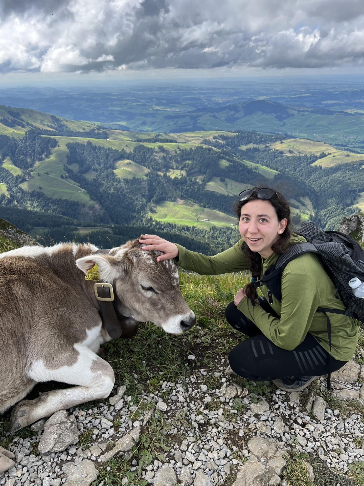

---
title: "Dumas Lab"
description: "Evolutionary ecology in the wild | Écologie évolutive en milieu naturel"
---

ECOLOGY · EVOLUTION · WILDLIFE

# Understanding how wildlife evolves in a changing world.

We study the ecological and evolutionary processes shaping wild populations, with a particular interest in sexual dimorphism, quantitative genetics, and environmental change.

<a class="lab-button" href="research_projects.html">
Explore our research ↗
</a>
<a class="lab-text-link" href="join_the_lab.html">
Join the lab →
</a>

A little bit of ecology, a little bit of evolution.

WELCOME TO THE LAB

## Wildlife, evolution, and the natural world.

We are an evolutionary ecology research group at Laurentian University, in Sudbury, Ontario.

Our research combines long-term ecological data, fieldwork, and quantitative methods to understand how wildlife populations respond to environmental change — and how evolutionary processes shape those responses.

WHAT WE DO

## Three questions. One wild world.

<a class="lab-text-link" href="research_projects.html">
All research →
</a>

01 / EVOLUTION

### Sexual dimorphism

How do males and females differ in their responses to selection? What determines the evolution of sex-specific traits?

02 / ENVIRONMENT

### Evolution in a changing world

How do wild populations respond to environmental change? Can evolutionary processes keep pace?

03 / POPULATIONS

### Wildlife population dynamics

How do individual variation, environmental conditions, and landscape change influence population persistence?

COME WORK WITH US

## Curious about ecology and evolution?

We are always interested in connecting with people who are passionate about wildlife, ecology, evolution, and quantitative approaches to understanding the natural world.

<a class="lab-button lab-button-light" href="join_the_lab.html">
Join the lab →
</a>

Hi there! I'm Michela. 

I'm a quantitative ecologist with a particular interest for sexual selection. I aim to answer questions related to the evolution of sexual dimorphism in the wild using long-term individual-based datasets. I'm also broadly interested in the effects of climate change and direct human impacts on wild populations. 

Currently, I am Wildlife Research Analyst with the Ontario Public Service (Ministry of Natural Resources). My work contributes to monitoring caribou populations in Ontario for the purpose of management and policy decision-making

Previously, I worked as a Postdoctoral Research Fellow at the University of Ottawa, where I built on work I undertook during my PhD under the supervision of Prof. Julien Martin (M.A.D. Lab, University of Ottawa, Canada) and Dr. Pierre Bize (Bize Lab, Swiss Ornithological Institute - Vogelwarte Sempach, Switzerland).

For more information on my work, check out [my projects](https://micheladumas.github.io/projects).

I spend most of my free time backpacking or otherwise enjoying the great outdoors. You'll find a smattering of photos from some of my favourite adventures throughout this website! 

# Education

 **Ph.D. in Biology** University of Ottawa, Ontario, Canada. 2020-2024.

 **M.Sc. in Ethology** Université Paris Sorbonne Nord, Ile-de-France, France. 2018-2020. 

 **B.Sc. in Biology** Honours, with speciallization in Ecology, Ecolution, and Behaviour, with a minor in Psychology. 2012-2017.
