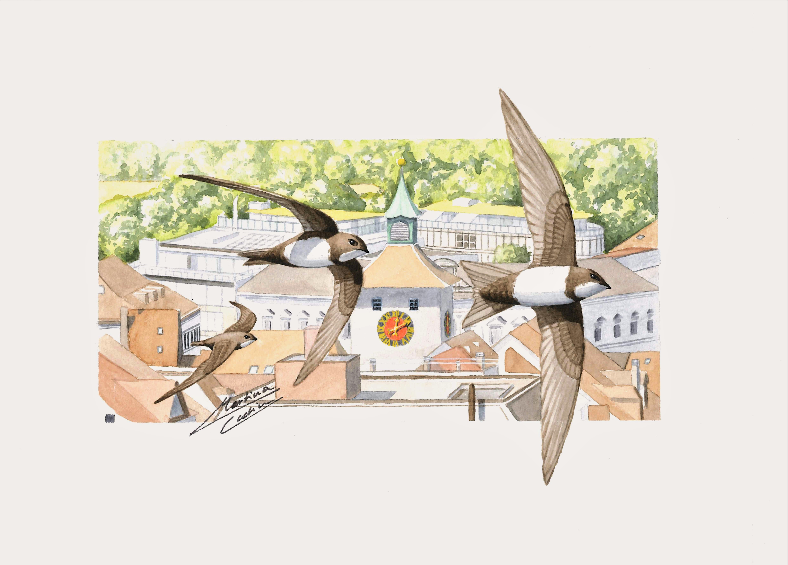

---
title: "Dumas Lab"
description: "Écologie évolutive en milieu naturel"
lang: fr
---

ÉCOLOGIE · ÉVOLUTION · FAUNE

# Comprendre l'évolution de la faune dans un monde en changement.

Nous étudions les processus écologiques et évolutifs qui façonnent les populations sauvages, en nous intéressant particulièrement au dimorphisme sexuel, à la génétique quantitative et aux changements environnementaux.

<a class="lab-button" href="projets_de_recherche.html">
Découvrir nos recherches ↗
</a>
<a class="lab-text-link" href="nous_joindre.html">
Joignez-vous à nous →
</a>

Un peu d'écologie, un peu d'évolution.

BIENVENUE AU LABORATOIRE

## La faune, l'évolution et le monde naturel.

Nous sommes un groupe de recherche en écologie évolutive à l'Université Laurentienne, à Sudbury, en Ontario.

Nos recherches combinent des données écologiques à long terme, du travail de terrain et des méthodes quantitatives pour comprendre comment les populations sauvages réagissent aux changements environnementaux — et comment les processus évolutifs façonnent ces réponses.

NOS RECHERCHES

## Trois questions. Un monde sauvage.

<a class="lab-text-link" href="projets_de_recherche.html">
Toutes nos recherches →
</a>

01 / ÉVOLUTION

### Dimorphisme sexuel

Comment les mâles et les femelles diffèrent-ils dans leurs réponses à la sélection? Quels facteurs déterminent l'évolution des traits propres à chaque sexe?

02 / ENVIRONNEMENT

### Évolution et changements environnementaux

Comment les populations sauvages réagissent-elles aux changements environnementaux? L'évolution peut-elle suivre le rythme de ces changements?

03 / POPULATIONS

### Dynamique des populations sauvages

Comment la variation individuelle, les conditions environnementales et les changements du paysage influencent-ils la persistance des populations?

JOIGNEZ-VOUS À NOUS

## La curiosité vous anime?

Nous souhaitons rencontrer des personnes passionnées par la faune, l'écologie, l'évolution et les approches quantitatives pour comprendre le monde naturel.

<a class="lab-button lab-button-light" href="nous_joindre.html">
Joignez-vous à nous →
</a>

