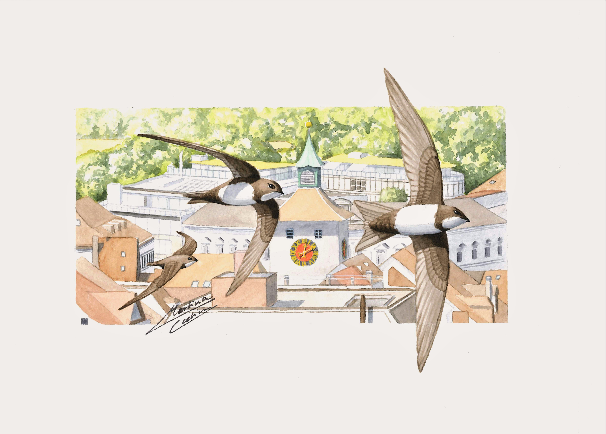

---
title: "Dumas Lab - Evolutionary Ecology in the Wild"
toc: false
---

Evolutionary Ecology · Sexual Dimorphism · Long-term Data · Individual Variation · Environmental Change

# Welcome!

The Dumas Lab is based at Laurentian University, in the School of Natural Sciences. We seek to better understand how wild populations respond to changing environments, with a particular focus on sex-specific differences. We use quantitative genetics, genomics, and long-term ecological datasets to investigate the importance of evolutionary processes in shaping current trends and to make predictions about species persistence in Northern Ontario and beyond.

Our research broadly seeks to answer the question: How do animals respond to changing environments, and how do evolutionary processes shape the future of wild populations?

# Research Themes

::: {.project-grid}

::: {.project-card}
{alt="Alpine swift in flight"}

### Evolutionary Ecology

How do natural and sexual selection shape variation and evolutionary change in wild populations?
:::

::: {.project-card}
{alt="Alpine swift in flight"}

### Sex-specific Evolution

Why do males and females differ, and how do evolutionary processes act differently between the sexes?
:::

::: {.project-card}
{alt="Alpine swift in flight"}

### Quantitative Genetics

How do genes and environmental conditions contribute to individual differences and evolutionary potential?
:::

::: {.project-card}
{alt="Alpine swift in flight"}

### Wildlife in a Changing World

How do climate change and human-driven environmental disturbance influence wildlife populations?
:::

:::

# An Inclusive Research Environment

We believe that excellent science benefits from diverse perspectives, experiences, and ways of thinking. We are committed to fostering a welcoming, respectful, and inclusive research environment where everyone feels valued, supported, and able to contribute.

We strive to provide equitable opportunities for learning, mentorship, and professional development, and to create a lab culture where curiosity, collaboration, and mutual respect are central.

# Explore the Lab

Interested in our research, looking for a research opportunity, or curious about joining the team? Explore our projects, meet the people behind the science, and get in touch!
